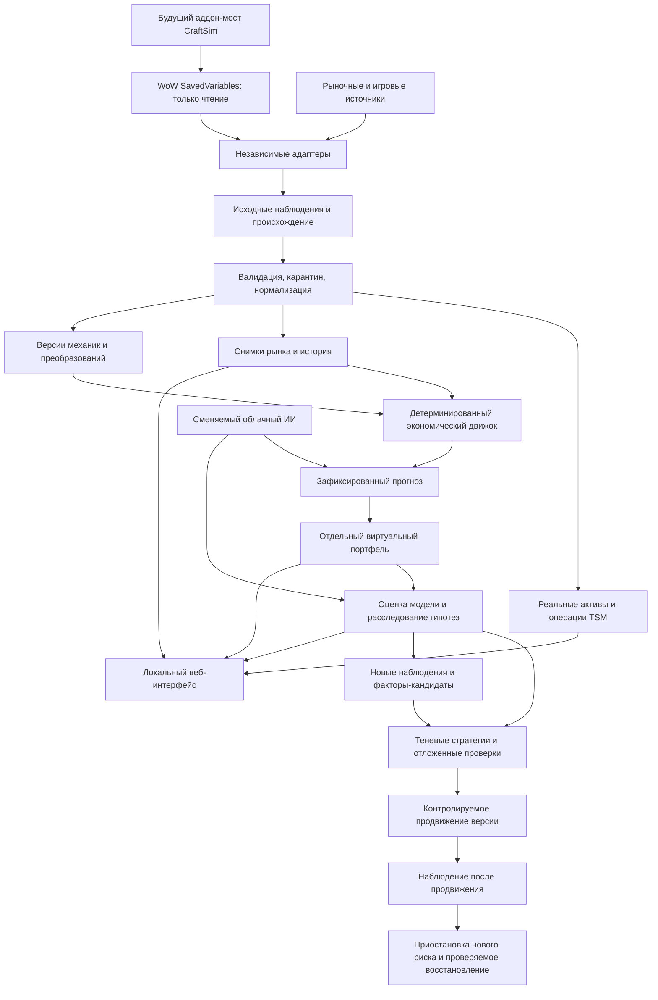

# Архитектура WoW Auction Intelligence

Текущий переход D2: подтверждённая часть этапа 2 принята, этап 3 разрешён; прежние формулировки о запрете этапа 3 ниже относятся к состоянию до D2. [Решение и архив](stage-3-transition.md).

## Реализация этапа 3

`knowledge_sources` получает один неизменяемый commit и его полный Git tree, проверяет Git blob hashes и сохраняет загрузку для возобновления. `knowledge_att` статически разбирает весь согласованный корпус, не исполняя Lua. Отдельно фиксируются файлы зависимостей, конфигурация, неопределённые выражения, timeline/flavor и отсутствующие права на импортированные Wago/TSM таблицы. Полный обход источника не равен полноте игры и не доказывает количество выходов механики.

`knowledge_storage` — отдельная SQLite, DELETE/FULL, собственные application ID и schema. Это сохраняет принятые базы активов и рынка без миграции ради справочника. Импорт идёт с контрольными точками; опубликованная версия меняется после полного согласования manifest. Сравнение содержательных полей отделено от изменения provenance: новый source hash сохраняется, но одинаковый факт не запускает одинаковое исследование повторно. Вытеснение удалённых записей происходит только при завершённом новом корпусе; старые записи и явный rollback сохраняются. Предложения исправлений требуют текущих свидетельств разных upstream и отдельного решения проверяющего; само приложение не удостоверяет истинность введённой ссылки.

`knowledge_worker` выполняет недельные/патчевые проверки публичного ATT и diff на включённом ПК; журнал заданий, lease/retry и возобновление сохраняются. Это локальный процесс `knowledge-watch`, не установленная системная служба. После выключенного ПК проверка выполняется при запуске, время доступности не переносится назад. Задания изучения кандидатов/обратной связи остаются в очереди до подключения исследователя на этапе 6; платных AI-вызовов здесь нет.

Уточнение автономности: тот же обычный процесс автоматически вызывает `knowledge_local.LocalKnowledgePoller`, обнаруживает новый export и CraftSim/TSM recipe caches, определяет установленный build и не требует открытия рецептов/ручного scan. Пассивная часть собственного аддона сама перечисляет известные recipe IDs и опрашивает доступные читающие игровые API при обычной сессии; недоступные результаты остаются неизвестными. Полный готовый расчёт открытого рецепта — дополнительный источник. Пассивные схемы, cache facts и engine profile имеют разные DTO и гарантии. [Граница автономности](research/stage-3-autonomy.md), [уточнение пользователя](stage-3-transition.md).

Собственный `addons/WowAuctionBridge` экспортирует наблюдение готового расчёта CraftSim в собственные SavedVariables. Python не исполняет Lua и не вызывает WoW API. Содержимое экспортированных параметров образует fingerprint, ошибки готовности/возраста/build дают явный статус. Чистая переоценка фиксированного варианта сохраняет коэффициенты установленного движка; она не решает задачу выбора реагентов или рыночного исполнения. Метаданные TSM — отдельное локальное наблюдение шаблона предмета: `isBOP` не является доказательством binding конкретного экземпляра. Список непроверенных частей и REAL-процедуры — [runbook](stage3-runbook.md).

Дата актуализации: 26 октября 2026, Europe/Moscow. **Этапы 1 и 2 приняты в подтверждённой части; разрешён и реализуется этап 3.** Работающий локальный импорт описан в историческом [отчёте этапа 1](stage-1-report.md); рыночный импорт — в [отчёте этапа 2](stage-2-report.md). Этапы 4–7 остаются проектными; фактическая часть этапа 3 описана выше. Нормативные требования: `codex_handoff/`, `MAIN_CODEX_CORRECTION.md` и последующие прямые решения пользователя. Последнее решение полностью исключает получение и использование Blizzard Web API credentials. [Матрица замены источников](research/stage-2-no-blizzard-alternatives.md) имеет приоритет над прежними планами обязательной интеграции Blizzard. Исторические аудиты и принятые пакеты не переписываются. Runtime использует DELETE journal, не WAL.

## A-02. Работа без Blizzard Web API — действующее решение

После отрицательного аудита R1 этапа 2 исправлены source freshness, атомарная
привязка HTTP validators, общий deadline и ленивая загрузка секретов.
[Решения и проверки S2-01–04](review-responses/stage-2-r1-response.md) входят в
действующий контракт; новая полная приёмка ещё требуется. Рабочая пригодность
цены не выводится из успешного HTTP/наличия локального кэша. Default HTTP имеет
общий budget 30 с (максимум 60 с) и ограниченное завершение отдельного процесса;
job lease остаётся 180 с, потерявший его worker не публикует результат и не
останавливает очередь. Status/resolve и disabled/policy-blocked UE не читают
секреты. Неизвестная конфигурация ключа показывается как `not_inspected`.

Приложение запускается и импортирует локальные данные и TSM public CSV без каких-либо API-ключей. Blizzard OAuth отсутствует в рабочем маршруте, его API-домены запрещены транспортом; старые переменные окружения/поля Blizzard secrets игнорируются. Регистрация Developer API, телефон, Authenticator, чужие ключи и обход доступа не являются вариантами решения. Сохранённый чистый `market_blizzard.py` разбирает только переданные байты в автономных тестах: он не подключён к worker и не является альтернативным режимом запуска.

| Задача | Действующий маршрут и обоснование |
|---|---|
| Рабочие агрегаты цен | TSM public CSV: действующий импорт пяти наборов EU/Soulflayer без регистрации. Нулевая цена не котировка, `historical` не временной ряд, региональные показатели не локальная ликвидность |
| Глубина, количество, история | Адаптер Undermine с собственным ключом UE, без Battle.net. Разделены бесплатные и платные возможности. Пока нет ключа и не разрешён вопрос API/условий систематического хранения, сеть UE отключена; это явная недоступность, а не подстановка TSM-агрегата вместо книги |
| Рынок связанных миров | UE `request.realms[]`/`result[].realms`: `provider_connected_realm`, ключ = hash(provider, Retail, region, sorted unique slugs). Числовой Blizzard connected ID остаётся null. Исходный ответ/hash/received/available сохраняются; effective time членства неизвестно. Противоречащие живые свидетельства дают конфликт |
| Сопоставление источников | TSM `(provider, region, realm_slug)` работает самостоятельно как `realm_unresolved`; UE-группа не доказывает TSM mapping. Связь источников — отдельное свидетельство, не сравнение строки slug и не автоматический lookup в старом Blizzard mapping |
| Метаданные и build | Локальные TSM item cache, ссылки предметов, `.build.info`; видимая неполнота и возраст. Будущий read-only экспорт из разрешённых игровых API — этап 3. UE не предоставляет метаданные предметов |
| Глобальный каталог преобразований | Этап 3: полный обход зафиксированного доступного ATT-корпуса плюс законно доступные build-specific дополнения; CraftSim дополняет и рассчитывает конкретные механики. Полнота корпуса не равна полноте игры. Blizzard profession/tier/recipe indexes больше не обязательный маршрут |

Гарантии исходных auction ID, bid/time_left, бесплатной детализации всех вариантов и полного текущего справочника без Blizzard не сохраняются; даже Blizzard не гарантировал исполнения объявлений, полный каталог преобразований или серверных hotfix. Поэтому архитектура торгового анализа, цепочек, виртуального портфеля, ИИ и UI сохраняется, но допустимость конкретного расчёта определяется наличием необходимых входов. Нет глубины/варианта/рецепта — нет подтверждённой исполнимой оценки; допускаются только явно обозначенный сценарий или статус `unknown`.

Рыночное хранилище этапа 2 отдельно от принятой базы активов. TSM хранится как ограниченный рабочий кэш, без бессрочного архива/передачи в облако. Retention удаляет raw и нормализованные значения, оставляя происхождение и `replay_unavailable_due_to_retention`. Политика в 4 часа — локальное ограничение проекта, не выдуманный срок из лицензии TSM. Неясность условий UE отдельно зафиксирована в матрице: документация прямо описывает API для разработчиков, общие условия ограничивают систематический сбор; запрет сети — текущая консервативная политика проекта, не утверждение о незаконности API. Подтверждение допустимого использования/хранения позволит включить этот адаптер без переработки доменной модели и без Blizzard.

## 1. Границы и путь данных

Стрелки от ИИ означают предложения через проверяемые DTO. ИИ не изменяет рабочий алгоритм, записи источников или капитал напрямую. Реальные активы показываются пользователю, но не финансируют виртуальный портфель. Никаких исполнительных команд в WoW. Персонажные требования рецептов хранятся, **проверка возможности выполнения на персонажах пользователя отложена**. Рекомендация такого пути обязана показывать «доступность персонажу не проверена».

## 2. Обоснованные решения

| Решение | Основание и альтернативы | Условие пересмотра |
|---|---|---|
| Модульный Python-монолит с портами и адаптерами | Локальный один пользователь; проще восстановление, чем микросервисы. Ни одна доменная сущность не зависит от TSM/CraftSim/Undermine DTO | Измеренная нагрузка, несколько пользователей |
| Python 3.12+; отдельное окружение и закреплённые зависимости на этапе 1 | Требование ТЗ; локально доступен 3.13.7, но совместимость зависимостей ещё не проверена | Проверка поддерживаемых версий перед установкой |
| SQLite сначала; один координатор записи | Требование ТЗ; транзакции связывают импорт, версии и очереди. WAL допускает читателей при одном писателе [E-TECH-01] | Объём/латентность выше принятого нагрузочного бюджета |
| WAL только после выбора исправленной SQLite | Локально 3.50.4; официальная документация описывает WAL-reset defect и исправления [E-TECH-01]. Нельзя молча включить WAL на найденном runtime | Исправленная сборка/версия либо rollback journal и проверка конкурентности |
| FastAPI + валидируемые DTO — предпочтительный вариант, не установлен | OpenAPI и типизированная проверка подходят независимым адаптерам [E-TECH-02]. Flask проще, но потребует отдельных контрактов; Django даёт лишний административный стек | Малый прототип контрактов на этапе 1 |
| UI: серверные HTML-шаблоны с небольшими интерактивными компонентами; графики с отдельным JSON API | Меньше сборочных зависимостей. Полная SPA оправдана, только если таблицы/навигация требуют её. Конкретная библиотека пока не выбрана | Прототип UI и проверка удобства на этапе 7 |
| Фоновый worker и долговечная очередь в БД, независимые от открытой вкладки | Ответ HTTP не является надёжным расписанием. FastAPI BackgroundTasks — не хранилище заданий [E-TECH-03]. Redis/Celery для первого локального запуска не обоснованы | Доказанная потребность распределённых задач |
| TSM — источник уже существующего учёта; наша система хранит нормализованную проекцию | Не создаём замену Ledger; ручное связывание покупок/преобразований только поверх оригиналов | Подтверждённый пробел конкретного события |
| CraftSim рассчитывает механику; собственный движок оценивает рынок, капитал и исполнение | Характеристики снимка и вероятности/ожидания **модели CraftSim** сохраняются с версией, методом и доказательствами; joint PMF может быть unknown [C12]. «Средняя прибыль CraftSim» не равна гарантированной продаже | Договорённый контракт и сверка моста |
| Все источники — сменяемые; выбор по возможности, качеству и правам, не по названию | TSM агрегаты не заменяют глубину стакана, а документированный API не равен доступному аккаунту | [Матрица источников](sources.md) |

Общие решения сформированы на этапе 0; реализация ограничена этапами 1–2. Системные службы и постоянный автозапуск не устанавливались. Worker этапа 2 работает отдельным явно запущенным процессом; закрытие этого процесса останавливает сбор.

## 3. Обязанности модулей

- `ingestion`: адаптеры, стабильное чтение, исходный hash, схема/версия, карантин; никакого исполнения Lua.
- `identity_assets`: регион, realm/connected-realm, псевдоним учётной записи, персонаж, владельцы хранилищ; согласование источников без сложения дублей.
- `market`: снимки и полнота, лестницы цены/количества, отдельные агрегаты, история доступности; не реконструирует «продажи» из исчезновения лота.
- `transformations`: независимая база механик всех дополнений, совместные случайные исходы, ограничения, происхождение и обновления; CraftSim — один расчётный адаптер.
- `economics`: потребление ресурсов, многоступенчатые пути, капитал, расходы, сценарии ликвидности, размер позиции и альтернативная стоимость.
- `forecast_portfolio`: неизменяемый прогноз, отдельные виртуальные книги по модели исполнения, исторические и проспективные испытания.
- `TechnicalQuality`: ошибки файлов, API, единиц, расчётов, схем; не подменяет оценку экономической модели.
- `TradingModelEvaluation`: отклонения прогнозов, калибровка, забытые факторы, неожиданные прибыли и верные исходы с неверным основанием.
- `HypothesisInvestigation`: конкурирующие объяснения, источник/контрпример, способ опровержения, статус причины; открытый запрос новых наблюдений и версионированный registry измеримых факторов, не закрытый перечень причин [S0-04](research/factor-discovery-r2.md).
- `StrategyExperimentation`: заранее зарегистрированные сравнения, отложенные/будущие данные и теневые версии. Отдельный надзор активации следит за уже продвинутой стратегией, останавливает новые рисковые рекомендации и проводит восстановление без переписывания портфеля [S0-02](research/strategy-lifecycle-r2.md).
- `KnowledgeCorrection`: версионированное исправление подтверждённых фактов; от пользовательской жалобы до независимых текущих источников и регрессии.

Контракты адаптеров: `probe`, `capabilities`, `fetch/read`, `validate`, `normalize`, `health`. Возможности явно перечисляют глубину, историю, времена, варианты, полноту и ограничения прав. Отсутствующее поле — `unknown`, а не 0. Автоматическое переключение источника не должно смешивать несовместимые цены и задним числом менять прогноз.

## 4. Импорт и согласование

1. Обнаружить разрешённую папку Retail; не читать каталоги авторизации. Путь подтверждён локально, автообнаружение будущего приложения не реализовано.
2. Для SV ждать стабильных размера/mtime, читать ограниченный объём, повторно сверять метаданные/hash; при гонке повторить с задержкой. Проверять завершённость синтаксиса и корневые переменные. Не считать mtime временем каждого поля.
3. Разбирать только допустимое подмножество литералов Lua. Запрет `eval`, `dofile`, выполнения кода, неограниченной вложенности/размера и небезопасной распаковки. Новая схема — карантин, старый подтверждённый снимок остаётся видимым с возрастом.
4. Исходное наблюдение, нормализованные записи и checkpoint импорта фиксируются транзакционно. Повтор одного hash не меняет итоги. `.bak` — резервная копия, не второй источник активов.
5. Область полноты задаётся на контейнер: исчезнувшая вещь означает ноль только в новом полном подтверждённом снимке этого контейнера. Неосмотренный банк остаётся неизвестным/устаревшим.
6. Выбирать значение по полю/области и качеству, а не складывать BagSync + GX + TSM. Банк отряда имеет одного владельца аккаунт/регион; гильдейский банк исключён по умолчанию. Несогласие свежих источников отражается отдельным конфликтом.
7. Дедупликация операций по документированному source ID; у найденного TSM его нет. Нужны версии мультимножества CSV по scope/family, matching агрегированных записей и revisions: TSM объединяет сделки в пределах 300 секунд и меняет quantity [L06]. Один row hash либо ordinal не годится как стабильный ID. Одинаковые легитимные продажи не схлопываются в одну; удаление/trimming не порождает отрицательную сделку. Неоднозначные изменения идут на reconciliation. CSV экспорт и SV того же Ledger — два представления одного происхождения.

AppHelper AppData — отдельный выход Desktop App, не SavedVariables. Его `LoadData(...)` не исполняется: будущий адаптер разбирает строго разрешённую оболочку и формат payload. Предпочтительнее публичный CSV для доступных агрегатов; локальный AppData нужен для подтверждённых дополнительных возможностей и auto-detect с учётом условий использования. GX имеет собственный autosave/ReloadUI, но проект не включает и не использует его [L12].

## 5. Работа без игры, после сна и сбоев

Мониторинг сети живёт в worker на включённом ПК. Закрытая игра означает только старение локальных активов/характеристик. Выключенный/спящий ПК не собирает снимки; после пробуждения фиксируется gap. Backfill допустим, если источник реально отдаёт историю и права позволяют её хранение; фактическое `available_at` никогда не переносится назад. Для точного воспроизведения состояния приложения такая запись исключена до available_at. Для отдельно помеченной условной публичной реконструкции нужен доказанный интервал публикации **конкретной версии**, задержка обработки и конец окна агрегата; неизвестность не заменяется timestamp события. Контракты пяти режимов и ежедневных агрегатов: [S0-03/S0-05](research/temporal-evaluation-r2.md).

Задания содержат idempotency key, next-run, lease/heartbeat, retry count, результат; зависший lease возвращается в очередь. 429/Retry-After, 401, таймауты, schema drift различаются. Poll cadence выводится из контрактов и последних snapshot IDs, не из обещания «ровно раз в час». На новый ценовой снимок пересчитываются затронутые зависимости без обязательного ИИ. Еженедельное исследование и внеплановая проверка патчей сначала сравнивают hashes/версии/пробелы; ИИ получает только изменённый материал. На этапе 0 эти задачи **не созданы**.

Raw-архив, БД и резервная копия находятся вне Git. Срок хранения зависит от источника и прав; требование воспроизводимости не даёт права бессрочно хранить данные. Для источника с неясными условиями запретить долгий backtest, пока вопрос не разрешён. Оставлять manifest удаления; hash без исходных данных не обеспечивает полный replay. Резервирование SQLite — через согласованный backup, не копированием одного файла живой WAL-БД.

## 6. Облачный ИИ и доверие

Провайдер/модель сменяемые; модель и prompt version фиксируются для каждой рекомендации. ИИ получает компактные обезличенные факты, а не весь SV или ключи. Вывод проходит schema validation, повторную проверку арифметики, существования evidence ID и hard constraints. Полученные статьи — недоверенные данные; инструкции из них не исполняются. Нет shell/записи исходников/доступа к секретам у торгового агента.

Временной фильтр входных данных не удаляет знания из параметров LLM. Современная модель на старой истории по умолчанию даёт только исследовательский исторический результат с неизвестной временной чистотой, а не строгий point-in-time тест. Exact stored replay читает записанное решение без нового вызова модели и сохраняет исходную оценку чистоты. Прогнозирующий и расследующий контексты имеют раздельные памяти, retrieval snapshots и допуски: поздние выводы аудитора не попадают в повторный старый прогноз. Модельные параметры/alias, prompt, полный разрешённый контекст, tool IO и ошибки сохраняются; недоступность провайдерских внутренних состояний явно ограничивает воспроизводимость. Подробно: [temporal-evaluation-r2.md](research/temporal-evaluation-r2.md).

Платный ИИ можно отключить; загрузка и арифметика продолжаются. Для расходов — готовая статистика провайдера, без своей бухгалтерии токенов. Для OpenAI организационная статистика в официальном примере требует Admin key [E-AI-01]; расширенные права необязательны, при их отсутствии стоимость `unknown`, пользователь смотрит кабинет. Ключ запросов и ключ статистики разделены. При задержке расходов локальная остановка новых запросов не гарантирует точного денежного потолка. Повтор после сетевого таймаута не должен молча повторять платное исследование.

Backend слушает loopback; проверка Origin/Host, CSRF для изменений, закрытый CORS, защищённая сессия и маскирование журналов проектируются на этапе 7. Секреты только на backend в локальном хранилище/окружении [E-AI-02]. Уведомления подключаются отдельно; отправки в этапе 0 нет.

## 7. Контур исследования ошибок модели

Полная экономическая спецификация и синтетические случаи: [economics-and-model-audit.md](research/economics-and-model-audit.md). Прогноз фиксируется **до** исхода с ценой, горизонтом, диапазоном, факторами, альтернативами, отменой, стратегией, версиями механик/источников/исполнения. Аудитор восстанавливает только доступную тогда информацию и отдельно перечисляет поздние сведения. Независимость обеспечивается отдельной задачей, контрактом и источниками; другая модель сама по себе независимость фактов не гарантирует.

Для модельной ошибки — минимум две конкурирующие гипотезы, где возможно, плюс обычная случайность. `confirmed` требует проверяемого механизма и данных, исключающих существенные альтернативы; совпадение патчноута и движения цены само по себе недостаточно. `plausible` допускает только теневой эксперимент, `unknown` не изменяет стратегию. Даже подтверждённая ошибка не доказывает пользу предлагаемого исправления: нужны отдельные отложенные и будущие испытания, ограничения риска, журнал и откат.

Необъяснённый остаток открывает запрос на недостающие наблюдения; новое измерение/отношение получает собственный FactorCandidate и проверку novelty, доступности во времени и полезности. Слепой тест обязан отличать это от закрытого классификатора причин и от ответа unknown всегда: [factor-discovery-r2.md](research/factor-discovery-r2.md).

`unknown` запрещает менять экономическую логику по догадке, но не отменяет заранее утверждённый защитный запрет нового риска при нарушении лимита/качества данных/контрольного порога. Уже открытые позиции, cost lots и committed reservations переживают паузу/смену версии без пересоздания. Прежняя стратегия после смены рынка проходит текущую revalidation и не считается безопасной автоматически. При отсутствии допустимой версии сохраняется режим без новых рисковых рекомендаций; причинное расследование продолжается отдельно.
